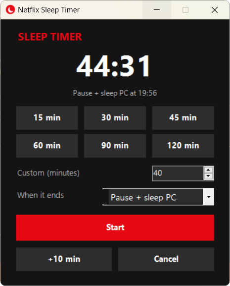
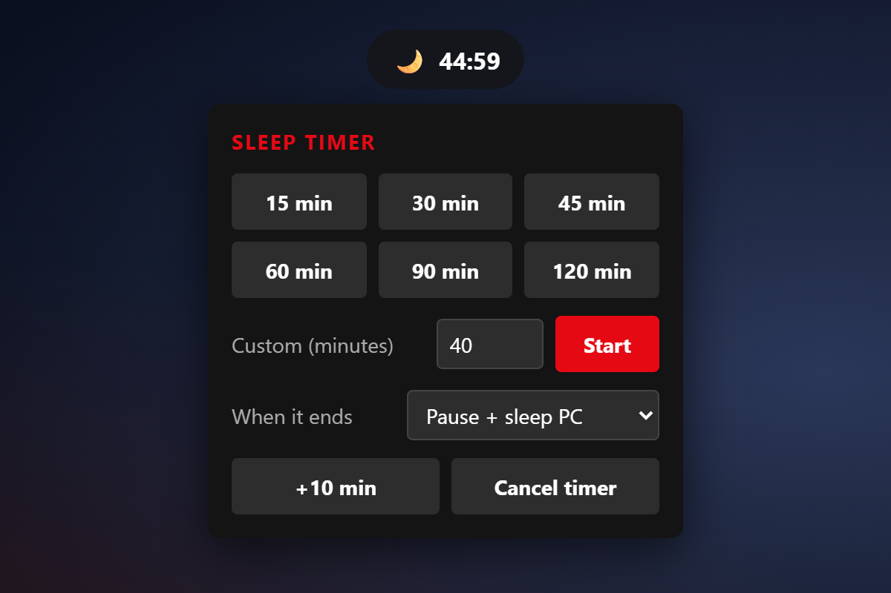

  

<h1 align="center">Netflix Sleep Timer</h1>

  Fall asleep to Netflix without it playing all night. 
  Counts down, fades the sound out, pauses, then puts your Windows PC to sleep.

  
  &nbsp;
  

## Features

- **One-click timers**: 15 / 30 / 45 / 60 / 90 / 120 min, or any custom length, with **+10 min** to extend
- **Gentle ending**: the sound fades out over the last minute, with a *Still watching?* prompt to add 15 min
- **Then**: pause only, turn the screen off, sleep the PC, or shut it down
- **Two ways to use it**
  - **Desktop app**: works with the Netflix app and Netflix in any browser (pauses only what is playing, so a paused Spotify stays paused)
  - **In the Netflix player**: a moon button right in Chrome / Edge, works in fullscreen
- **Quick to open**: Desktop and Start menu shortcuts, or **Ctrl + Alt + N** from anywhere

## Install

Windows 10 / 11, nothing else to install.

1. [Download the ZIP](../../archive/refs/heads/main.zip) (or clone) and unzip it somewhere permanent.
2. Double-click **`Install.bat`**. This adds the shortcuts and the hotkey.
3. *Optional, for the button inside Netflix:* open `chrome://extensions` (or `edge://extensions`), turn on **Developer mode**, click **Load unpacked** and pick the `extension` folder.

To remove it, run `powershell -ExecutionPolicy Bypass -File Install.ps1 -Uninstall`, then remove the extension from the extensions page.

## How it works

| Part | What it is |
| --- | --- |
| `NetflixSleepTimer.ps1` | Desktop timer (PowerShell + WinForms). Pauses through Windows media sessions. |
| `extension/` | Chrome / Edge extension that adds the timer to the Netflix player. |
| `native-host/` | Small helper the extension calls to sleep, turn off the screen or shut down. It only accepts those three commands. |
| `Install.ps1` | Creates the shortcuts and registers the helper for your user account (no admin needed). |

---

Personal project, not affiliated with or endorsed by Netflix.
